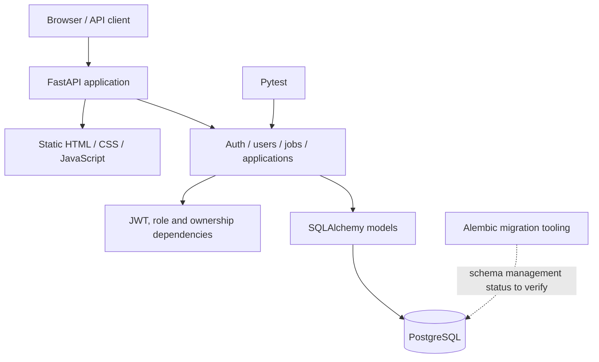

# Job Portal API — Architecture

Public routes expose job search and registration. Authenticated routes apply role and ownership checks before reading or changing job and application records. The static interface is served by the same FastAPI application.
