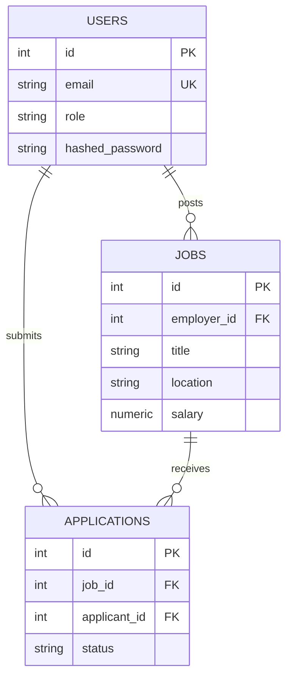

# Job Portal API — Database ER Diagram

Conceptual model based on the documented domain. Confirm exact column names, nullability, and constraints against `app/models.py` and the live database schema.
